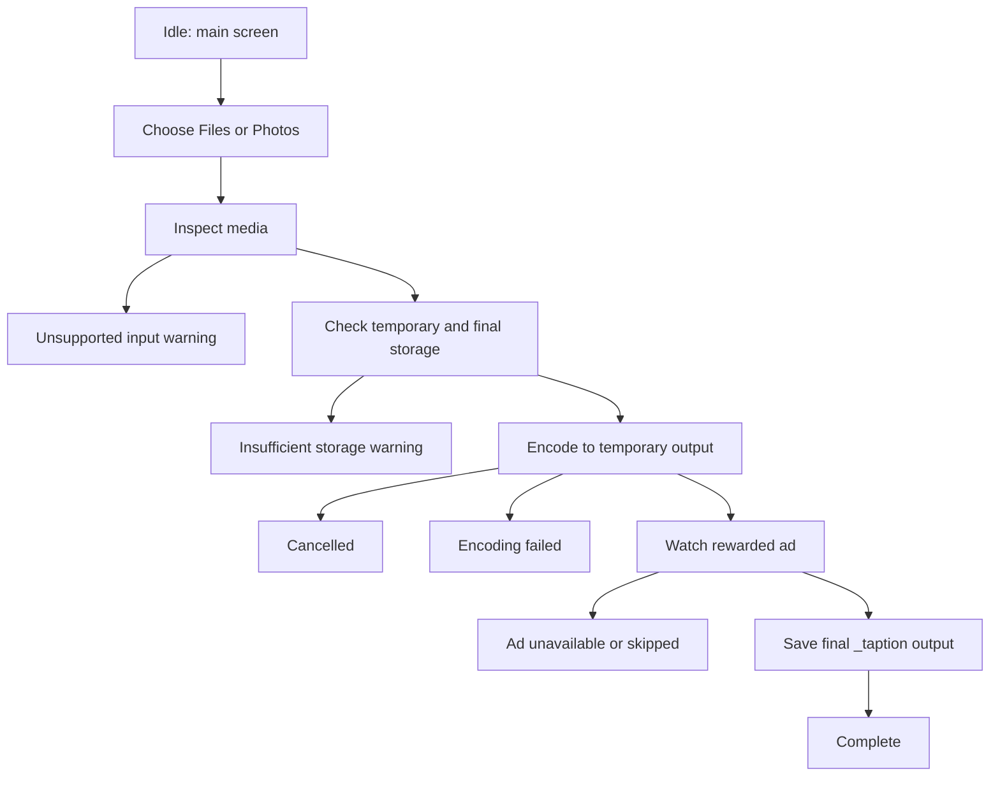
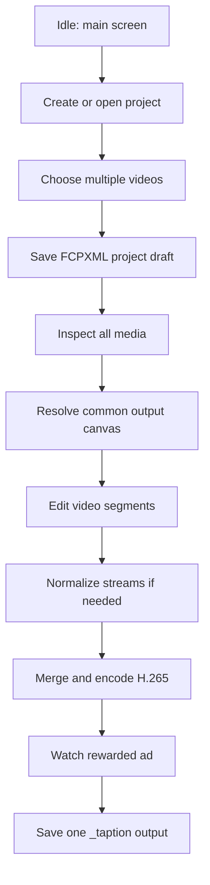
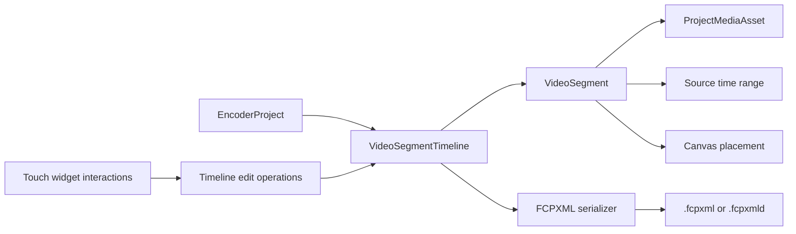
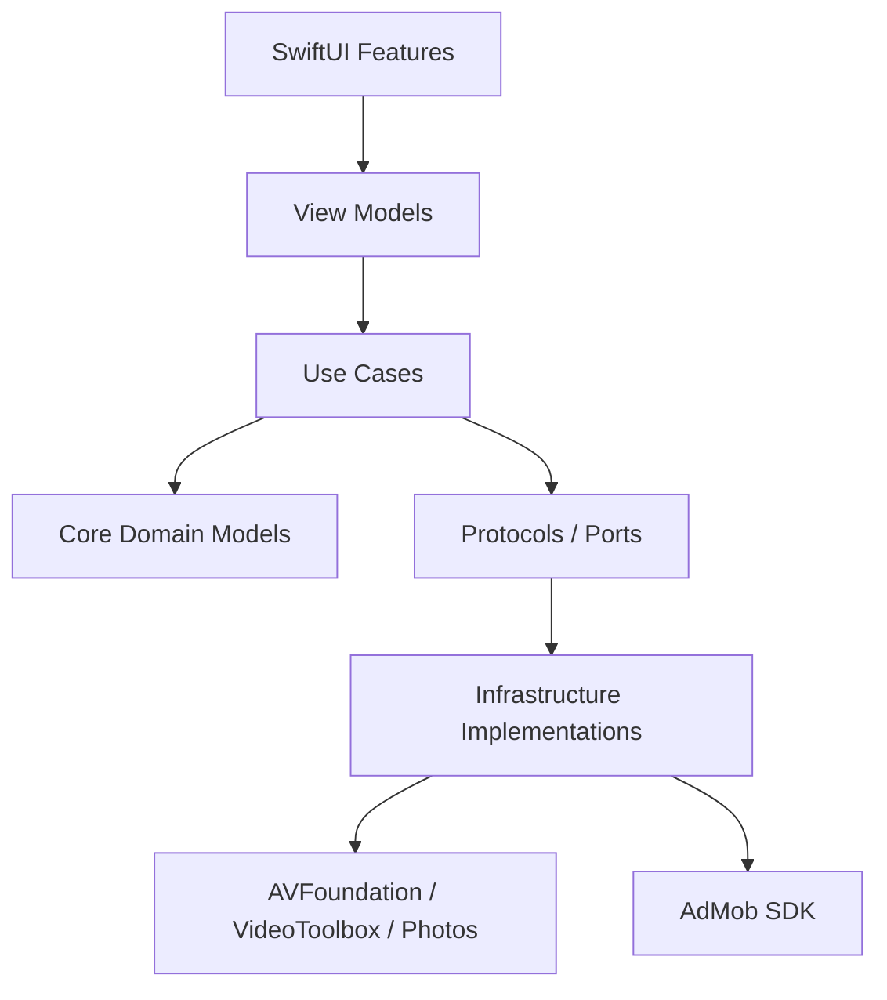

# Taption Encoder App Architecture

## Product Direction

Taption Encoder is a free, phone-first video encoder that makes conversion simple enough to run directly on iPhone or iPad. The final product goal is "almost any practical user video in, H.265 out" with hardware or software codecs, old-device support where practical, background encoding where the OS allows it, and multi-video assembly into one output. The app must stay separate from the main Taption editor unless a file is intentionally ported.

The product core is convenience: choose one or more videos, keep the original look by default, encode with minimal setup, optionally do small edits, and get a saved H.265 output. Advertising supports the free business model; it should be dense enough to monetize the app, but it is not the product's purpose.

Core value:

- Product path: AV1 to H.265 first, All to H.265 final.
- Convert many video formats to H.265 without making the user understand codecs.
- Preserve source-like resolution, timing, orientation, color, audio timing, and visual quality by default.
- Combine multiple videos into one output, including videos from different cameras and formats.
- Normalize sources for merge when needed, especially when codecs, containers, frame rates, color metadata, or audio layouts differ.
- Merge normalization is user-selectable when values meaningfully differ; effectively equivalent values can be auto-mapped to the closest recommended value.
- Keep the first experience simple, then add advanced output controls later.

Primary constraints:

- iPhone and iPad portrait only.
- Minimum OS is iOS/iPadOS 18.0 for the current SwiftVLC software fallback binary; lower OS support requires a codec stack built for that target.
- iPad uses the same centered, mobile-width UI and flow as iPhone.
- Visible app strings stay in English.
- MVP input is AV1 video.
- MVP output is fixed to H.265 video in an `.mp4` container.
- Long-term output remains H.265 video, with future container/preset choices around that H.265 stream.
- Default output should preserve the source video's resolution, frame rate, orientation, aspect ratio, and color characteristics whenever technically possible.
- Default quality should target visually source-like output, not aggressive compression.
- Hardware encoding is preferred automatically when supported.
- Software fallback is automatic, not user-selectable, and the UI displays the path actually used.
- Software codec paths are required for unsupported hardware codecs, broad input support, simulator validation, and older-device fallback.
- Older devices should be supported where performance, OS APIs, and codec availability make the experience honest.
- Files and Photos are the first input sources.
- Encoding starts immediately after a valid file is selected.
- Progress and cancellation are first-class states.
- Progress should include a determinate bar, percent complete, processed duration, and estimated time remaining when enough samples are available.
- In-app progress should be mirrored to supported system surfaces through Live Activities where available.
- Output is saved with `_taption` appended to the source name.
- A storage check must run before producing final output.
- Monetization is ad-supported. There is no planned paid version.
- AdMob banner is shown on the main screen and other eligible in-app screens.
- AdMob rewarded ad is required before final save.
- Initial ad requests should be non-personalized.
- Additional ad formats should be added at natural pauses, not during active encoding or file selection.

## Non-Goals For The MVP

- Main Taption editor integration.
- Subtitle editing or export UI.
- Monetization flows beyond AdMob banner and rewarded save gate.
- Multi-output format selection.
- Resolution, frame-rate, quality, or bitrate UI.
- Multi-file merge UI.
- Detailed timeline editor UI.
- Guaranteed indefinite background execution on every iOS version.

## Product Phases

### Phase 0: Shell And Architecture

- Lock device family to iPhone and iPad.
- Lock orientation to portrait.
- Establish the app module layout.
- Build the main screen with Files, Photos, and Reset actions.
- Add automatic codec-path information with hardware preferred by policy.
- Add output summary fixed to H.265.
- Add placeholder surfaces for banner ads, progress, cancellation, storage errors, and rewarded-save flow.
- Add ad placement containers for banner, app-open, interstitial, native, and rewarded save ads behind protocol abstractions.

Implementation status, 2026-06-15:

- Phase 0 app structure is in place.
- `AppEnvironment`, feature flags, app configuration, Home feature files, core protocol directories, and fake services compile.
- The main screen has the required Phase 0 surfaces, but real encoding, Photos import, AdMob SDK integration, and rewarded save execution remain later-phase work.

### Phase 1: AV1 To H.265 MVP

- Detect AV1 video input by codec metadata, not only file extension.
- Preserve source resolution, frame rate, orientation, aspect ratio, SDR/HDR mode, color primaries, transfer function, and color matrix where the source and encoder path expose that metadata.
- Preserve audio by passthrough where compatible; otherwise transcode to a broadly compatible format.
- Use a source-derived bitrate or quality profile that prioritizes visual match over smallest file size.
- Resolve a writable destination with `_taption` appended.
- Estimate storage before encoding and before final move/copy.
- Encode to a temporary app-owned output first.
- Require rewarded ad completion before final save.
- If rewarded save cannot finish, persist the completed temporary output and restore a pending-save state on the next launch so the user can retry without re-encoding.
- Move or copy the completed file to the resolved destination.
- Support cancellation while encoding.
- Surface whether the job is using Hardware Encoder or Software Encoder.
- Integrate AdMob SDK with Debug test ad units and production configuration placeholders.
- Add privacy consent and tracking flows before requesting ads.

Implementation status, 2026-06-15:

- The Phase 1 main UX/state-machine shell is implemented with fake services before real encoding.
- Files and Photos entry points can drive fake importing, inspecting, storage checking, encoding progress, cancellation, rewarded-save waiting, pending-save recovery, and completed states.
- Real AV1 inspection, H.265 conversion, Photos asset handling, AdMob SDK integration, and final save execution remain for later implementation phases.

### Phase 2: Reliability And Proof

- Add deterministic simulator tests with fake encoder and fake ad gate.
- Add deterministic simulator tests with fake banner, app-open, interstitial, native, and rewarded ad providers.
- Add simulator UI verification for iPhone and iPad portrait layouts.
- Add device proof with real AV1 samples.
- Add error taxonomy for unsupported codec, unreadable input, unwritable destination, insufficient storage, ad failure, cancellation, and encoder failure.
- Add lightweight job history for the current session.
- Add ad frequency telemetry and remote-configurable placement switches.
- Add ETA smoothing and speed estimates based on processed media duration.
- Add Live Activity proof for active foreground-started jobs.

### Phase 3: Broad Input And Legacy Device Support

Output remains H.265 while input format support expands. This phase adds a backend strategy for "almost any practical user video" and older-device fallback.

- H.264 / AVC
- H.265 / HEVC
- VP9
- VP8
- MPEG-2 Video
- ProRes
- Other codecs supported by the selected software codec backend, subject to licensing and App Store constraints

Container support expands:

- MP4 (`.mp4`)
- QuickTime Movie (`.mov`)
- M4V (`.m4v`)
- WebM (`.webm`)
- Matroska (`.mkv`)
- AVI (`.avi`)
- MPEG transport streams (`.ts`, `.mts`, `.m2ts`)
- MXF (`.mxf`)

Backend expansion:

- AVFoundation / VideoToolbox first for Apple-native inputs and hardware acceleration.
- Software decode/encode backend for formats and devices that Apple-native APIs do not cover.
- Capability checks that explain whether a job is running hardware, software, or mixed decode/encode.
- Thermal, battery, and speed warnings for older devices.
- Software codec options may include FFmpeg-family technology if App Store review, licensing, binary size, and performance constraints are satisfied.
- Broad input support may increase the app binary size when that is necessary for practical codec coverage.

### Phase 4: Multi-File To Single Output With Simple Editing

- Select multiple files.
- Create or open an Encoder project.
- Store merge/edit timelines as native `.fcpxml` project files.
- Inspect compatibility before merge.
- Preserve source-like defaults when inputs match.
- Normalize video streams when inputs differ, using user-selected options unless the values are effectively equivalent.
- Allow merge when sources come from different cameras or formats.
- Require or create a common output canvas/resolution before merge.
- Allow simple pre-merge edits:
  - trim clip start/end
  - cut unwanted ranges
  - split a clip into video segments
  - shorten a clip
  - reorder clips
  - adjust clip position on the output canvas when needed
- Use video segments as the editing unit, borrowing Taption's segment editing concepts without importing subtitle/editor code by default.
- Merge multiple inputs into a single H.265 output.
- Reuse the same storage, progress, ETA, cancellation, background-status, and rewarded-save gates.

### Phase 5: Encoding Controls

Expose options that are represented in the architecture from the beginning:

- Resolution changes
- Frame-rate changes
- Quality presets
- Bitrate controls
- Output container presets while still using H.265 video
- Color-map, tone-map, and HDR/SDR conversion controls

### Phase 6: Advanced Workflows

- Batch conversion.
- Per-file presets.
- Format-specific compatibility warnings.
- Multi-camera merge presets.
- Optional compression-first presets for users who want smaller output instead of source-like output.

## Main User Flow



## Merge And Lightweight Editing Flow



Merge rules:

- Different input formats and cameras are allowed.
- If source resolutions match, use that resolution as the default output canvas.
- If source resolutions differ, ask the user to choose a target canvas or use a recommended canvas.
- Normalize frame rate, color metadata, audio layout, orientation, and timing before final merge when needed.
- If detected values are meaningfully different, show a normalization menu with available source values and a recommended common value.
- If detected values are effectively equivalent, auto-select the closest recommended value and show that choice in the merge summary.
- The first selectable normalization groups should be output canvas/resolution, frame rate, color handling, audio layout, and orientation handling.
- Preserve source-like quality by default after normalization.
- Keep editing simple and clip-based, not a full nonlinear editor.

Lightweight edit tools:

- Trim clip start/end.
- Cut unwanted ranges.
- Shorten a clip by setting a shorter out point.
- Split a clip into two video segments at the playhead or touched boundary.
- Reorder clips.
- Adjust clip position on the output canvas when the clip needs fit/fill/center positioning.
- Later: duplicate clip, mute audio, and simple fade handles if the core merge workflow is stable.

### Project File And FCPXML Strategy

Future merge/edit work needs a project file concept before it grows into a full editor. The native project save format is FCPXML so the app has a durable timeline document and a path to Final Cut Pro interchange from the beginning.

Project rules:

- Treat `.fcpxml` as the native save format for Encoder projects, not only an import/export format.
- Keep a pure Swift domain model in memory, then serialize to and parse from FCPXML.
- Do not let SwiftUI views mutate XML directly.
- Start with a single-file `.fcpxml` project document.
- Add `.fcpxmld` bundle support later for thumbnails, proxies, richer metadata, and generated project resources.
- In `.fcpxmld`, keep `Info.fcpxml` as the canonical timeline document inside the bundle.
- Allow a future managed `.fcpxmld` project mode that copies original media when the user chooses it.
- Choose and pin the target FCPXML DTD version before implementation.
- Validate generated FCPXML against the selected DTD in tests.
- Store Taption Encoder-only metadata in a safe metadata namespace or sidecar so exported FCPXML remains compatible with professional video apps.
- Keep media references external by default; copy source videos only when the user explicitly chooses a managed-project mode.

Taption concept mapping:

- Taption subtitle segment becomes `VideoSegment`.
- Taption subtitle timeline becomes `VideoSegmentTimeline`.
- Taption touch widget becomes direct video-segment controls for trim handles, split handles, reorder/move affordances, and canvas placement handles.
- Taption slice/split behavior becomes a non-destructive `SplitVideoSegmentOperation` that creates two segments pointing at the same source asset with adjusted source time ranges.
- Taption edit ownership becomes `SegmentEditOwnership`, so preview, hit testing, touch routing, and commit calculations stay aligned.
- Taption movement preview lessons apply here too: the visible preview cursor and the final committed edit must use the same target calculation.



```swift
struct EncoderProject: Equatable, Identifiable {
    var id: UUID
    var title: String
    var assets: [ProjectMediaAsset]
    var timeline: VideoSegmentTimeline
    var outputOptions: EncodingOptions
    var fcpxmlVersion: FCPXMLVersion
}

struct VideoSegmentTimeline: Equatable {
    var segments: [VideoSegment]
    var outputCanvas: OutputCanvas
}

struct ProjectMediaAsset: Equatable, Identifiable {
    var id: UUID
    var source: SourcePickerResult
    var metadata: MediaMetadata
}

struct VideoSegment: Equatable, Identifiable {
    var id: UUID
    var assetID: ProjectMediaAsset.ID
    var sourceRange: ClosedRange<TimeInterval>
    var timelineStart: TimeInterval
    var placement: ClipPlacement
    var audioPolicy: SegmentAudioPolicy
}

enum TimelineEditOperation: Equatable {
    case trim(segmentID: VideoSegment.ID, start: TimeInterval, end: TimeInterval)
    case split(segmentID: VideoSegment.ID, at: TimeInterval)
    case reorder(segmentID: VideoSegment.ID, destinationIndex: Int)
    case place(segmentID: VideoSegment.ID, placement: ClipPlacement)
}
```

```swift
struct MergeTimeline: Equatable {
    var clips: [MergeClip]
    var outputCanvas: OutputCanvas
    var outputOptions: EncodingOptions
}

struct MergeClip: Equatable, Identifiable {
    var id: UUID
    var source: SourcePickerResult
    var metadata: MediaMetadata
    var edit: ClipEdit
    var placement: ClipPlacement
}

struct ClipEdit: Equatable {
    var trimStart: TimeInterval
    var trimEnd: TimeInterval
    var cutRanges: [ClosedRange<TimeInterval>]
}

struct OutputCanvas: Equatable {
    var width: Int
    var height: Int
    var frameRate: FrameRateOption?
    var colorPolicy: ColorMappingPolicy
}

struct ClipPlacement: Equatable {
    var mode: ClipPlacementMode
    var offsetX: Double
    var offsetY: Double
    var scale: Double
}
```

## Default Output Policy

The default user promise is simple: convert to H.265 while keeping the source look. This is a source-preserving default, not a mathematically lossless guarantee, because H.265 encoding is still a transcode.

Default preservation targets:

- Resolution
- Pixel aspect ratio and display aspect ratio
- Orientation and transform
- Frame rate and timing
- SDR/HDR mode
- Color primaries
- Transfer function
- YCbCr matrix
- Bit depth where supported
- Audio track timing
- Audio passthrough where compatible
- Creation metadata where safe and relevant

Default quality policy:

- Prefer visually source-like output over aggressive size reduction.
- Use source-derived bitrate, quality, profile, and level decisions.
- Avoid hidden resizing, frame-rate conversion, tone mapping, or color conversion unless required for H.265 compatibility.
- If a preservation target cannot be kept, surface it as a clear compatibility note.

Future advanced controls may intentionally change these properties, but MVP and broad-format defaults should not.

## Codec Backend Strategy

Broad format support requires multiple codec paths. Apple-native APIs are preferred when they work, while software codecs provide coverage for unsupported inputs, older devices, simulator validation, and future merge normalization.

```swift
enum CodecExecutionMode: Equatable {
    case hardware
    case software
    case mixedDecodeSoftwareEncodeHardware
    case mixedDecodeHardwareEncodeSoftware
}

enum CodecBackend: Equatable {
    case avFoundation
    case videoToolbox
    case softwareCodec
}

struct CodecCapability: Equatable {
    var inputCodec: InputCodec
    var inputContainer: InputContainer
    var decodeBackend: CodecBackend
    var encodeBackend: CodecBackend
    var executionMode: CodecExecutionMode
    var isRecommended: Bool
    var warning: String?
}
```

Backend policy:

- Prefer hardware H.265 encoding when available.
- Use software fallback automatically when hardware H.265 is unavailable, native decode fails, selected settings are unsupported, or simulator/legacy fallback is required.
- Use software decoding for input codecs/containers not supported by AVFoundation.
- Keep software codec integration behind protocols so licensing, binary size, and App Store risks are contained.
- Add a license review before shipping any bundled third-party codec stack.
- Display the actual path used: `Hardware Codec Path`, `Software Codec Path`, or `Mixed Codec Path`.
- For older devices, expose honest speed/thermal warnings instead of pretending the experience will match newer hardware.

## Progress And Background UX

Encoding progress should be a shared stream that drives the in-app UI, Live Activity state, and tests.

```swift
struct EncodingProgress: Equatable {
    var fractionCompleted: Double
    var processedDuration: TimeInterval
    var totalDuration: TimeInterval?
    var elapsedTime: TimeInterval
    var estimatedTimeRemaining: TimeInterval?
    var currentSpeed: Double?
    var backend: EncoderBackend
    var phase: EncodingPhase
}
```

Progress rules:

- Always show a determinate progress bar when total duration is known.
- Show percentage when `fractionCompleted` is available.
- Show elapsed time immediately.
- Show estimated time remaining after enough progress samples are collected.
- Smooth ETA with a moving average so the displayed time does not jump every frame.
- Keep cancel available while the encoder can still stop safely.

System-surface rules:

- Use Live Activities for active encoding status on the Lock Screen, Dynamic Island, StandBy, and other supported system surfaces.
- Do not request notification permission for the MVP.
- On iOS and iPadOS 26 or later, let users choose background encoding and use `BGContinuedProcessingTask` for user-started jobs that should continue after the app moves to the background.
- On iOS/iPadOS 18-25, use `beginBackgroundTask` only to finish short critical cleanup or finalization; do not promise long background encoding.
- If background continuation is unavailable, tell the user to keep the app open for reliable long encodes.
- Never show full-screen ads while a background continuation task is active.

## UI Design

The UI should feel like a compact utility, not a media editor. The first screen is the actual converter, not a marketing page.

### Main Screen Layout

Top to bottom:

- AdMob banner area.
- App title: `Taption Encoder`.
- Subtitle: `AV1 to H.265`.
- Source actions:
  - `Files` with `folder`.
  - `Photos` with `photo.on.rectangle`.
  - `Reset` with `arrow.counterclockwise`.
- Codec path info:
  - `Codec Path: Automatic`
  - `Hardware is used where supported. Software fallback is automatic.`
- Output summary:
  - `Output`
  - `H.265`
- Status area:
  - selected filename
  - current backend
  - progress bar
  - percentage
  - elapsed time
  - estimated time remaining
  - cancel button when active
- Optional native ad slot in idle and completed states only.

### Layout Rules

- Keep the main content width constrained, currently around 420 points.
- Use the same content density on iPhone and iPad.
- Avoid split-view, sidebar, or iPad-only alternate navigation.
- Do not expose future controls until they work.
- Use disabled or hidden architecture-only options internally, not visible UI.
- Prefer SF Symbols for utility actions.
- Keep ads visually separated from primary controls to reduce accidental taps.
- Do not place banner ads directly next to source buttons, cancel buttons, or picker actions.

### State Model

```swift
enum HomeScreenState: Equatable {
    case idle
    case importing
    case inspecting
    case storageBlocked(StorageIssue)
    case encoding(EncodingProgress)
    case waitingForReward(CompletedTemporaryOutput)
    case saving
    case completed(SavedOutput)
    case failed(EncodingError)
    case cancelled
}
```

## Source Tree Plan

The current project is small. The first implementation pass should move from a single `ContentView` toward this shape:

```text
TaptionEncoder/
  App/
    TaptionEncoderApp.swift
    AppEnvironment.swift

    Features/
    Home/
      HomeView.swift
      HomeViewModel.swift
      HomeScreenState.swift
    Encoding/
      EncodingProgressView.swift
      EncoderModePicker.swift
      OutputSummaryView.swift
      EncodingTimeRemainingView.swift
    MergeEditor/
      MergeEditorView.swift
      MergeEditorViewModel.swift
      ClipListView.swift
      ClipTrimView.swift
      ClipPlacementView.swift
      VideoSegmentTimelineView.swift
      SegmentTouchWidgetView.swift
      SliceSplitControl.swift
    Project/
      ProjectBrowserView.swift
      ProjectDocumentView.swift

  Core/
    Encoding/
      EncodingJob.swift
      EncodingOptions.swift
      EncodingProgress.swift
      EncodingPhase.swift
      EncodingProgressEstimator.swift
      EncoderBackend.swift
      EncoderService.swift
      EncoderPipeline.swift
      SourcePreservationPolicy.swift
      CodecBackend.swift
      CodecCapability.swift
    MediaInspection/
      MediaInspector.swift
      MediaMetadata.swift
      InputCodec.swift
      InputContainer.swift
      ColorMetadata.swift
      AudioTrackMetadata.swift
    Merge/
      MergeTimeline.swift
      MergeClip.swift
      OutputCanvas.swift
      MergeCompatibilityInspector.swift
      MergeNormalizationPlan.swift
      MergeEncodingPipeline.swift
    Editing/
      VideoSegment.swift
      VideoSegmentTimeline.swift
      ClipEdit.swift
      ClipPlacement.swift
      ClipPlacementMode.swift
      TimelineEditOperation.swift
      SegmentEditOwnership.swift
      TouchWidgetInteraction.swift
      SplitVideoSegmentOperation.swift
      TimelineEditValidation.swift
    Project/
      EncoderProject.swift
      ProjectDocument.swift
      ProjectFileVersion.swift
      FCPXMLVersion.swift
      FCPXMLProjectParser.swift
      FCPXMLProjectSerializer.swift
    FileAccess/
      SourcePickerResult.swift
      DestinationResolver.swift
      OutputNamingPolicy.swift
      SecurityScopedFileAccess.swift
    Storage/
      StorageChecking.swift
      StorageEstimate.swift
      StorageIssue.swift
    Ads/
      AdGate.swift
      AdPlacementPolicy.swift
      BannerAdProviding.swift
      AppOpenAdProviding.swift
      InterstitialAdProviding.swift
      NativeAdProviding.swift
      RewardedAdProviding.swift
    Background/
      BackgroundEncodingCoordinator.swift
      BackgroundEncodingCapability.swift
      EncodingLiveActivityBridge.swift

  Infrastructure/
    AVFoundation/
      AVFoundationMediaInspector.swift
      AVAssetReaderDecoder.swift
      AVAssetWriterHEVCEncoder.swift
      AVFoundationColorMetadataMapper.swift
    VideoToolbox/
      VideoToolboxHardwareCapabilities.swift
    SoftwareCodecs/
      SoftwareCodecMediaInspector.swift
      SoftwareCodecDecoder.swift
      SoftwareCodecHEVCEncoder.swift
      SoftwareCodecLicenseNotice.swift
    BackgroundTasks/
      ContinuedProcessingEncodingTask.swift
      BackgroundTaskFallback.swift
    ActivityKit/
      EncodingLiveActivity.swift
    AdMob/
      AdMobAdConfiguration.swift
      AdMobAppOpenAdManager.swift
      AdMobBannerView.swift
      AdMobInterstitialAdProvider.swift
      AdMobNativeAdView.swift
      AdMobRewardedAdGate.swift
    Photos/
      PhotosSourceLoader.swift
      PhotosOutputSaver.swift
    FCPXML/
      FCPXMLReader.swift
      FCPXMLWriter.swift
      FCPXMLDTDValidator.swift
      FCPXMLMetadataMapper.swift

  Shared/
    UI/
      PrimaryActionButton.swift
      StatusBanner.swift
      ProgressCard.swift
```

## Layer Responsibilities



### UI Layer

- Owns layout, user actions, and display state.
- Does not inspect codecs directly.
- Does not talk to AdMob directly.
- Does not know where temporary or final files live.

### Use Case Layer

Recommended use cases:

- `ImportVideoUseCase`
- `InspectMediaUseCase`
- `PrepareEncodingJobUseCase`
- `RunEncodingUseCase`
- `CancelEncodingUseCase`
- `RequestRewardedSaveUseCase`
- `FinalizeSaveUseCase`
- `InspectMergeSourcesUseCase`
- `BuildMergeTimelineUseCase`
- `ValidateMergeCompatibilityUseCase`
- `ApplyClipEditUseCase`
- `CreateProjectUseCase`
- `OpenProjectUseCase`
- `SaveProjectUseCase`
- `ImportFCPXMLUseCase`
- `ExportFCPXMLUseCase`
- `ApplyTouchWidgetEditUseCase`
- `SplitVideoSegmentUseCase`
- `RunMergeEncodingUseCase`

### Domain Layer

The domain layer should remain pure Swift where possible.

```swift
enum InputCodec: Equatable {
    case av1
    case h264
    case hevc
    case vp9
    case vp8
    case mpeg2Video
    case proRes
    case unknown(String)
}

enum InputContainer: Equatable {
    case mp4
    case mov
    case m4v
    case webm
    case mkv
    case avi
    case mpegTransportStream
    case mxf
    case unknown(String)
}

enum OutputCodec: Equatable {
    case hevc
}

enum OutputContainer: Equatable {
    case mp4
    case mov
}

enum EncoderBackend: Equatable {
    case hardware
    case software
}

struct SourcePreservationPolicy: Equatable {
    var preserveResolution: Bool = true
    var preserveFrameRate: Bool = true
    var preserveOrientation: Bool = true
    var preserveColorMetadata: Bool = true
    var preserveHDR: Bool = true
    var preserveAudioTiming: Bool = true
    var preferAudioPassthrough: Bool = true
}

struct EncodingOptions: Equatable {
    var backend: EncoderBackend
    var outputCodec: OutputCodec
    var outputContainer: OutputContainer
    var preservation: SourcePreservationPolicy
    var resolution: ResolutionOption?
    var frameRate: FrameRateOption?
    var quality: QualityOption?
    var bitrate: BitrateOption?
    var colorMapping: ColorMappingPolicy?
}
```

Future project and edit models should remain domain-first:

```swift
enum ProjectFileKind: Equatable {
    case fcpxml
    case fcpxmlBundle
}

enum SegmentAudioPolicy: Equatable {
    case preserve
    case muted
}

struct SegmentEditOwnership: Equatable {
    var activeSegmentID: UUID?
    var activeInteraction: TouchWidgetInteraction?
}

enum TouchWidgetInteraction: Equatable {
    case trimStart
    case trimEnd
    case split
    case reorder
    case canvasPosition
}
```

### Infrastructure Layer

- AVFoundation handles Apple-native media inspection and reader/writer paths.
- VideoToolbox capability checks decide whether strict hardware encoding is available.
- Software codec infrastructure handles unsupported input formats, simulator proof, and older-device fallback.
- AdMob implementation stays behind `AdGate` and banner protocols.
- Photos implementation stays behind source and output saver protocols.
- Future FFmpeg-family integration, if adopted, must be introduced as another software codec backend instead of leaking into UI.

## Encoding Pipeline

```mermaid
flowchart LR
    Input["Source URL or Photos asset"] --> Access["Open access"]
    Access --> Inspect["Inspect codec/container"]
    Inspect --> Validate["Validate AV1 for MVP"]
    Validate --> Destination["Resolve output name"]
    Destination --> Space["Check storage"]
    Space --> Temp["Create temp output"]
    Temp --> Encode["Decode input and encode HEVC"]
    Encode --> Reward["Rewarded ad gate"]
    Reward --> FinalSave["Move/copy to final destination"]
    FinalSave --> Done["Saved output"]
```



## Background Architecture

Background behavior should be treated as progressive capability, not a single guarantee across all devices.

```swift
enum BackgroundEncodingCapability: Equatable {
    case continuedProcessing
    case shortFinalizationOnly
    case unavailable
}

protocol BackgroundEncodingCoordinator {
    func capability() -> BackgroundEncodingCapability
    func begin(job: EncodingJob) async throws
    func update(progress: EncodingProgress) async
    func complete(result: EncodingResult) async
    func cancel() async
}
```

Implementation policy:

- iOS/iPadOS 26 or later: offer a background encoding option and use BackgroundTasks continued processing for user-started encoding where available.
- iOS/iPadOS 18-25: use short background task time only for cleanup, file closing, and final metadata writing.
- Live Activity updates should continue while the app has runtime and should end with a completed, failed, or cancelled state.
- The app should persist enough job state to recover cleanly if the system terminates the process.
- A background-capability message should be visible before long jobs if the device cannot continue encoding reliably in the background.

### Backend Policy

Hardware backend:

- Default recommendation.
- Uses strict hardware capability checks where possible.
- Displays `Hardware Encoder`.
- If hardware is unavailable or native decode fails, switch automatically to the software fallback when available.

Software backend:

- Info-only fallback display; HW/SW is not a user-selectable mode.
- Displays `Software Encoder`.
- Slower but useful for broad codec coverage, older-device compatibility, compatibility testing, and simulator validation.
- May be disabled or warned when the estimated runtime, thermal load, or memory use is not acceptable for the current device.

Mixed codec path:

- Uses different decode and encode backends when necessary.
- Displays `Mixed Codec Path`.
- Common examples: software decode for unusual input, hardware H.265 encode for output; hardware decode for native input, software H.265 encode when hardware settings are unavailable.

Simulator validation:

- UI and state-machine behavior should be validated with fake encoder services.
- Backend selection should be testable in simulator.
- Real hardware performance still requires device validation.

## Save Policy

### Files Source

- Keep security-scoped access open for the selected file when possible.
- Generate the output name from the original source:
  - `sample.mp4` -> `sample_taption.mp4`
  - `sample.mov` -> `sample_taption.mp4`
- Use H.265 video in an MP4 container for the first release unless the encoder implementation proves MOV is safer.
- Write to a temporary app-owned file first.
- After rewarded ad completion, move or copy to the final sibling destination.
- If rewarded save is unavailable, skipped, or interrupted, keep the completed temporary output and store a pending-save record.
- On the next launch, restore the pending-save record and show the user a save retry path without re-encoding.
- If the file provider does not allow sibling writes, surface a save-location fallback instead of silently failing.

### Photos Source

- Photos assets do not expose a normal writable sibling file location.
- Export the selected original to an app-owned temporary input.
- Encode to an app-owned temporary output.
- After rewarded ad completion, save a new video asset to Photos.
- If rewarded save cannot complete, keep the temporary output and restore a pending Photos save state later.
- Preserve `_taption` in the generated local filename and any supported metadata, even if Photos does not display filenames directly.

## Ads Architecture

Ads are the only planned business model, but remain app infrastructure, not encoder logic. The product should feel like a free, convenient encoder first; ads should monetize natural pauses, idle surfaces, and save gates without corrupting the encoding workflow.

```swift
protocol AdGate {
    func prepare() async
    func requireRewardBeforeSave() async throws
}

protocol BannerAdProviding {
    associatedtype BannerView
    func makeBannerView() -> BannerView
}

protocol AppOpenAdProviding {
    func preload() async
    func showIfEligible() async
}

protocol InterstitialAdProviding {
    func preload(placement: InterstitialPlacement) async
    func showIfEligible(placement: InterstitialPlacement) async
}

protocol NativeAdProviding {
    associatedtype NativeAdView
    func makeNativeAdView(placement: NativeAdPlacement) -> NativeAdView
}
```

Rules:

- Use Google test ad unit IDs in Debug builds.
- Keep production ad unit IDs in configuration, not scattered through views.
- Initial ad requests should be non-personalized; personalized ads or cross-app tracking require a later policy change and ATT handling.
- Rewarded ad must gate final save, not temporary encoding.
- If rewarded ad fails to load, the user can retry now, keep the temporary result for later, or cancel the pending save.
- Encoding output should remain temporary until the reward succeeds.
- Pending rewarded-save jobs should survive app relaunch so completed encodes do not need to run again.
- Do not show full-screen ads while a picker is open, while encoding is active, or while cancellation is being processed.
- Do not place banner or native ads close enough to primary buttons to invite accidental taps.
- Use remote-configurable placement switches and frequency caps so ad load can be tuned after launch without a binary update.
- Add a visible privacy options entry point when required by the consent SDK.
- Add an in-app path to report inappropriate ads if required by App Store review.

### Ad Placement Strategy

Maximize ad coverage through allowed, predictable placements:

- App open ad: on cold launch or foreground return, only when no encoding job is active and a loading/return transition is visible.
- Anchored adaptive banner: persistent top placement on the main screen, idle state, encoding status, completed state, failed state, and cancelled state.
- Native ad: idle state below the output summary, completed state below the saved-file confirmation, and non-blocking history/result areas when those exist.
- Interstitial ad: natural pauses only, such as after a completed save, after a cancelled job returns to idle, or after a failed job acknowledgement. Avoid showing immediately before a rewarded save ad.
- Rewarded ad: explicit `Watch Ad to Save` action after encoding finishes and before moving/copying the final output.

### Ad Policy Guardrails

- Rewarded save must disclose the exact reward before each ad: saving the completed H.265 output.
- Rewarded save must require a clear user opt-in, such as a `Watch Ad to Save` button.
- Skipping or dismissing a rewarded ad should leave the temporary output pending and offer retry/cancel instead of pretending the save succeeded.
- Interstitial ads must have an obvious close path and must not surprise the user during active work.
- Test ads are mandatory during development and simulator/device QA.
- Production ad unit IDs are only allowed in release configuration.

## Storage Architecture

```swift
protocol StorageChecking {
    func availableBytes(for url: URL) throws -> Int64
    func estimatedRequiredBytes(for job: EncodingJob) -> Int64
    func validateSpace(for job: EncodingJob) throws
}
```

Storage checks:

- Check before encoding starts.
- Check again before final save.
- Use conservative estimates because H.265 output size depends on bitrate, duration, resolution, and quality settings.
- Future bitrate and quality controls should feed into the estimate.

## Error Taxonomy

```swift
enum EncodingError: Error, Equatable {
    case unsupportedInputCodec(InputCodec)
    case unsupportedContainer(InputContainer)
    case unreadableInput
    case unwritableDestination
    case insufficientStorage(StorageIssue)
    case hardwareEncoderUnavailable
    case adRewardRequired
    case adUnavailable
    case cancelled
    case encoderFailed(String)
}
```

User-facing error text must be short and in English.

## Test Plan

### Unit Tests

- `OutputNamingPolicyTests`
- `HomeScreenStateTests`
- `EncodingOptionsTests`
- `StorageCheckingTests`
- `AdGateFlowTests`
- `MediaInspectionTests`
- `EncoderBackendPolicyTests`
- `SourcePreservationPolicyTests`
- `EncodingProgressEstimatorTests`
- `BackgroundEncodingCapabilityTests`
- `CodecCapabilityTests`
- `MergeCompatibilityInspectorTests`
- `MergeNormalizationPlanTests`
- `ClipEditValidationTests`
- `VideoSegmentSplitTests`
- `VideoSegmentTimelineTests`
- `TouchWidgetInteractionTests`
- `SegmentEditOwnershipTests`
- `ProjectDocumentTests`
- `FCPXMLRoundTripTests`
- `FCPXMLValidationTests`
- `OutputCanvasTests`

### Simulator Tests

- iPhone portrait layout.
- iPad portrait layout with the same centered mobile-width UI.
- Files action presents picker.
- Photos action presents picker.
- Fake encoding shows progress and can be cancelled.
- Rewarded-save gate blocks final save until success.
- Hardware and Software labels display correctly.
- ETA appears after enough fake progress samples.
- Live Activity bridge receives progress updates through a fake provider.
- Merge editor can reorder, trim, cut, and reposition clips with fake media.
- Merge editor can split a fake clip into two video segments.
- Project save/open can round-trip a fake FCPXML timeline.
- Merge compatibility warnings appear for mismatched resolution, frame rate, color metadata, and audio layout.

### Device Tests

- Real AV1 input decodes.
- Hardware encoder path succeeds where supported.
- Software encoder path succeeds or reports a clear unsupported case.
- Output is playable as H.265.
- Output preserves source resolution, orientation, frame rate, and color metadata where supported.
- Storage warning appears before output when space is insufficient.
- Files output uses `_taption` naming.
- Photos output creates a new saved asset.
- Live Activity or equivalent supported system progress surface appears during active encoding.
- iOS 26+ continued background encoding is verified on a real device.
- iOS/iPadOS 18-25 fallback behavior is documented.
- Software codec fallback is verified on at least one older supported device.
- Mixed codec path is verified with an input not fully covered by Apple-native APIs.
- Multi-camera merge is verified with at least two different source containers/codecs.
- Merge output is playable as one H.265 video.
- FCPXML project output opens or validates against the selected FCPXML DTD.

## Acceptance Criteria For MVP

- App launches on iPhone and iPad in portrait only.
- iPad uses the same main screen UX as iPhone.
- Main screen has `Files`, `Photos`, and `Reset`.
- Encoder mode defaults to `Hardware`.
- Output displays `H.265`.
- Selecting a supported AV1 file starts encoding automatically.
- Progress is visible.
- Estimated time remaining is visible once enough progress is measured.
- Cancellation works.
- Default output preserves source-like resolution, timing, orientation, color, and quality where technically possible.
- Live Activity/system progress is available on supported OS/device combinations.
- Insufficient storage blocks output with a clear warning.
- Final save requires rewarded ad completion.
- Saved output name includes `_taption`.
- UI strings are English.
- Main Taption editor code is not pulled in accidentally.

## Acceptance Criteria For Final Product Direction

- The app can convert broadly used user video formats into H.265.
- The app chooses hardware, software, or mixed codec paths based on actual device and file capability.
- Older supported devices get honest compatibility, speed, and background behavior.
- The app can merge multiple videos from different cameras/formats into one H.265 output.
- The merge path supports trim, cut, split, shorten, reorder, and canvas placement.
- The app can save and open an FCPXML-based project file for merge/edit timelines.
- Video editing is modeled as video segments rather than subtitle segments.
- Advanced settings can change output container, size, frame rate, bitrate, quality, and color mapping.
- The default path stays simple and source-preserving.
